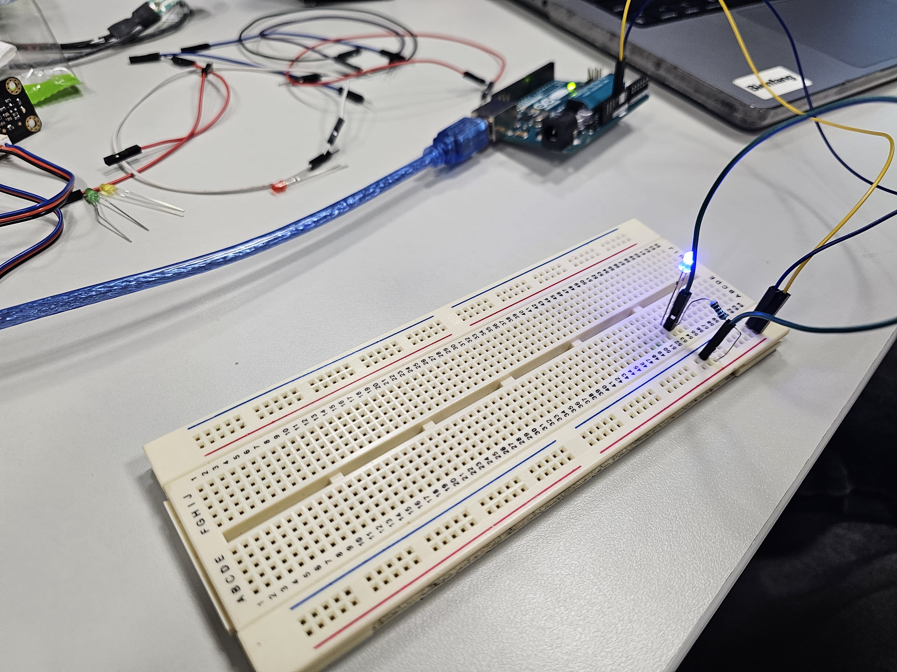

# Week 9 — Arduino Basics

<!-- Replace ## with the week number and Topic Name with the week's focus -->
<!-- You may also refer to each week's slide for the Topic Name -->
<!-- e.g. Week 03 — Arrays & Functions -->

---

### Activities

| Activity | What I Made                   |
| -------- | ----------------------------- |
| `8a-01`     | An always on LED. |
| `8a-02`     | A blinking LED. |
| `8a-03`     | A fading LED. |
| `8b`     | An LED that turns off based on sensor detection. |

<!-- Add or remove rows to match the activities for this week. -->

---

### This Week

<!-- A short, informal summary of what you explored across the week's activities. What did you make? What clicked? What didn't?
     A few sentences is all you need — write it like a journal entry, not a report. -->


We played with arduinos and building basic circuits. We then incorporated censors using code written in C++. The breadboards were really finicky and small coupled wth our unfamiliarity with electrical wiring led us to many instances where we were wondering why the bulbs did not light up. It was actually really fun. 

### Output

Activity 8a-01 - Always On LED


[Activity 8a-02 - Blinking LED](https://drive.google.com/file/d/1cwq5vp8AFk7_-R9rcIdEcHd61FPOSpfJ/view?usp=drive_link)

[Activity 8a-03 - Fading LED](https://drive.google.com/file/d/1WhVKdpepTDdDwh9Lm_kbenfPgKFxLk4C/view?usp=drive_link)

[Activity 8b - Proximity-Sensitive LED](https://drive.google.com/file/d/1nkcXE1i3sk94VMO_b86lItt2qSiGijx-/view?usp=drive_link)
<!-- Drop a screenshot, photo, or GIF of something you made this week.
     Save it to a readme-assets/ folder inside this week's folder.
     Made more than one thing worth showing? Add more images. -->

---

<!-- ─────────────────────────────────────────────────────
     GOING FURTHER — if you want to document more, here are some ideas:

     ### 1a — Activity Name
     
     What you tried, what you discovered.

     ### 1b — Activity Name
     
     What you tried, what you discovered.

     ### 🧩 Something I Found Interesting
     A line of code, a technique, a happy accident — paste it here.
     ```js
     // your code here
     ```

     ### ❓ Questions I'm Sitting With
     Anything unresolved, something you want to revisit, or a rabbit hole you fell into.

     ### 🔗 References
     Links to anything that helped or inspired you this week.
     ───────────────────────────────────────────────────── -->
