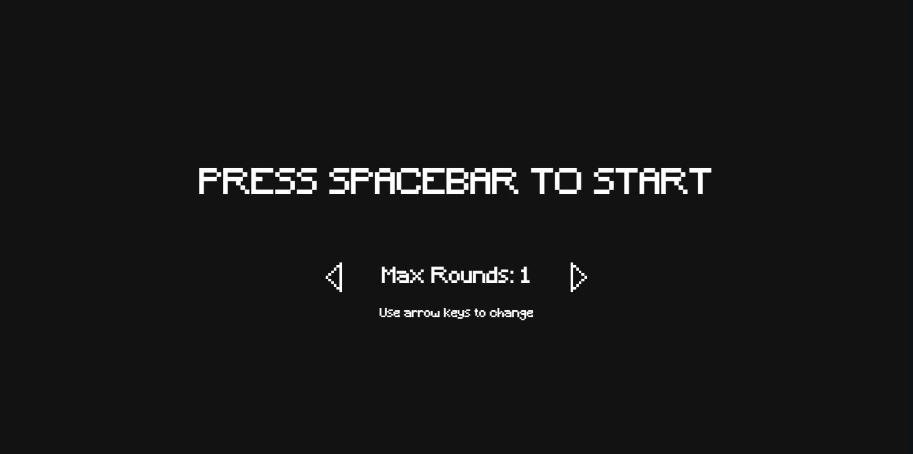
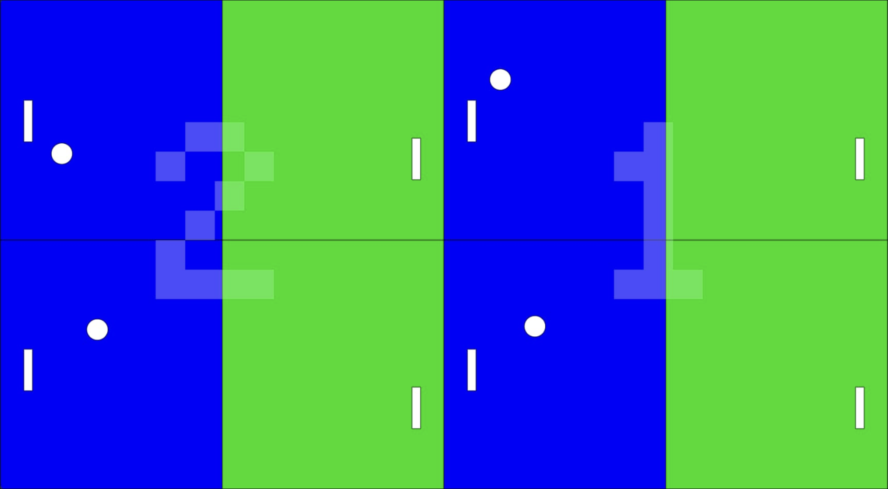

# Mini Project — MULTIVERSE PONG

<!-- Replace "Title" with the name of your project, e.g. "Mini Project — Pong Remix" -->

---

### The Project

We built a Pong game - except that for each subsequent round, players will have to battle in exponentially-multiplying instances of Pong.

---

### Output





<!-- Drop a screenshot or GIF of your finished project.
     Save it to a readme-assets/ folder inside this project folder.
     Got more than one good screenshot? Add them. -->

[Watch Online](https://drive.google.com/file/d/1S7nviCp3vghS7_zMNq5jd9DyWZiMFs0p/view)

<!-- Replace the link above with a URL to a screen recording or video of your project.
     ⚠️ Make sure the file or page is set to public before submitting. -->

---

### ✍️ Reflection

We chose the Pong assignment because we found a two-player experience more engaging than a single-player game like Flappy Bird. Inspired by 5D Chess With Multiverse Time Travel, we developed a variation of Pong featuring multiple simultaneous game instances, which also allowed us to explore JavaScript subclasses. The final game includes sound effects and a title screen, adding polish to the core gameplay.

The game uses keyboard inputs: W/S and the arrow keys control the paddles, A/D and the left/right arrow keys adjust round settings, while the spacebar starts or restarts the game.

Our biggest challenge was developing the screen division system. Syriaz did the heavy lifting.

The game is a little hard to play but I feel the project successfully achieves its original goals. Given more time, I would have further developed the visuals and maybe introduced some power ups.

---

<!-- ─────────────────────────────────────────────────────
     GOING FURTHER — want to document more? Try any of these:

     ### ✨ What I Changed
     A short list of the additions and modifications you made to the scaffold.
     - Changed the paddle to use mouse tracking instead of keyboard
     - Redesigned the visual language with a retro CRT aesthetic

     ### 🔍 Code Structure
     Briefly explain how your files are organised.
     - `sketch.js` — main game loop
     - `Ball.js` — ball class with collision logic
     - `assets/` — sprites and sounds

     ### 🧩 Something I'm Proud Of
     A snippet of code, a design decision, a moment where it clicked.
     ```js
     // your code here
     ```

     ### 🔗 References
     Anything that helped or inspired you — tutorials, artworks, tools.
     ───────────────────────────────────────────────────── -->
